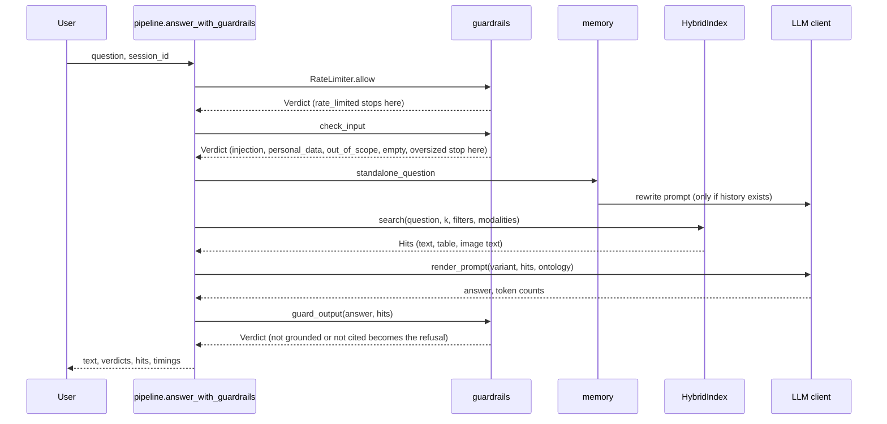

# Low-level design (Task A3)

Package `src/rag/`. Signatures are the ones in the code.

## Modules and interfaces
| Module | Contents |
|---|---|
| `elements.py` | `Element(doc_id, page, modality, text, image_path=None, metadata={})` (frozen; `element_id` = `doc|p<page>|<modality>|<el>|<chunk>`, `citation` = `doc, p.N`). `Hit(element, score, rank)`. `Modality` = text, table, image. |
| `parsers.py` | `parse_pdf(path, doc_id, image_dir, ocr=None, min_image_px=80, metadata=None)`, `parse_pptx(...)`, `parse_document(...)` by extension. Tables are read cell by cell from the page text (`_table_rows`) because `find_tables().extract()` lost spaces and decimal points. |
| `registry.py` | `load_registry(manifest, metadata)` maps a file name to its manifest `doc_id` and metadata. `attach_metadata(elements, info)`. |
| `ocr.py` | `rapid_ocr() -> OcrFn` (image path to text; returns "" on a failure). |
| `chunking.py` | `ChunkConfig(max_tokens, overlap, table_rows_per_chunk)`, `chunk_text`, `chunk_table` (header repeated in every chunk), `chunk_elements`. |
| `embedding.py` | `SentenceTransformerEmbedder(name, device, batch_size).embed(texts) -> (n, dim)` L2-normalised. Tests use `HashEmbedder`. |
| `index.py` | `BM25Index`, `DenseIndex`, `reciprocal_rank_fusion`, `HybridIndex.search(query, k, filters, modalities, mode)` with mode hybrid, bm25 or dense (single modes return true scores). `HybridIndex.save(dir)` / `HybridIndex.load(dir, embedder)`. |
| `memory.py` | `ConversationMemory(max_turns=5)`: `add`, `history_text`, `standalone_question(question, llm)`. |
| `llm.py` | `LLMClient.generate(prompt, **params) -> LLMResult(text, input_tokens, output_tokens, seconds)`. Implementations: `FakeLLMClient` (tests), `OllamaClient`, `HostedOpenAICompatibleClient` (settings from `RAG_LLM_BASE_URL`, `RAG_LLM_MODEL`, `RAG_LLM_API_KEY`). |
| `prompts.py` | `render_prompt(variant, question, hits, ontology)`; templates in `prompts/*.j2`. |
| `guardrails.py` | `check_input(question, has_history) -> Verdict`, `check_output(answer, hits, question) -> Verdict`, `guard_output`, `RateLimiter.allow(session_id)`. `Verdict(allowed, category, reason)`. |
| `pipeline.py` | `answer_question(...)` and `answer_with_guardrails(question, index, llm, limiter, session_id, memory, variant)`. |
| `eval_metrics.py` | `load_golden`, `recall_at_k`, `mrr`, `correctness` (optional judge LLM), `faithfulness`, `cites_retrieved`, `summarise`. |

## Schemas
- Golden question: `{id, question, modality, answer, doc_id, page, split}` (split dev or test). `load_golden` rejects duplicates and missing fields.
- Index folder: `elements.json` (list of Elements), `dense.npy` (one row per element), `ingest_summary.json`.
- Chunk metadata: `el`, `chunk`, `doc_type`, `topic`, `sensitivity`, `source`, `date` (see `ontology.yaml`).

## Sequence of one query

## Error handling
| Failure | Behaviour |
|---|---|
| A file does not parse | `ingest_corpus.py` records it in `failed` and goes on to the next file. |
| OCR fails on one image | `""` is returned; the image stays in the index with no text. |
| Ingestion interrupted | Each document is cached when parsed; a rerun skips cached documents. |
| Ollama not running | `RuntimeError` naming the host and `scripts/lab_start.sh`. |
| Hosted endpoint variable missing | `RuntimeError` naming the missing variable. The key never appears in error text. |
| Hosted endpoint HTTP error | `RuntimeError` with the status code only. |
| Index and matrix lengths differ on load | `ValueError`: index is corrupt. |
| Blocked question or answer | `Verdict` with a category; user sees `Not found in the documents.` |
